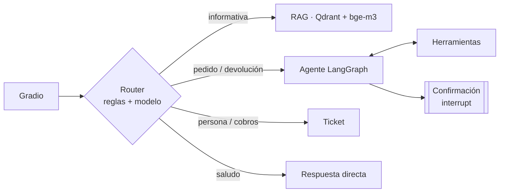

# EcoMarket · Agente de IA para devoluciones

Proyecto final: el asistente de atención al cliente de EcoMarket (Talleres 1 y 2) se convierte en un **agente que actúa**. Atiende consultas con RAG y automatiza el proceso de devolución: verifica la elegibilidad y genera la etiqueta de envío, con una interfaz web en **Gradio**, construido con **LangGraph** y desplegado con **Docker**.

> El modelo propone, el código dispone y la persona confirma.

## Entregables

| Fase | Documento |
|---|---|
| 1 · Arquitectura, herramientas, marco y flujo | [`docs/fase1_arquitectura.md`](docs/fase1_arquitectura.md) |
| 2 · Implementación, manejo de errores y evaluación | [`docs/fase2_implementacion.md`](docs/fase2_implementacion.md) |
| 3 · Riesgos, ética, monitoreo y mejoras | [`docs/fase3_analisis_critico.md`](docs/fase3_analisis_critico.md) |
| 4 · Despliegue con Gradio y Docker | [`docs/fase4_despliegue.md`](docs/fase4_despliegue.md) |
| Guion del video | [`docs/guion_video.md`](docs/guion_video.md) |

## Arquitectura en breve



**Herramientas del agente:** `consultar_pedido`, `verificar_elegibilidad_producto`, `generar_etiqueta_devolucion`, `escalar_a_humano` y `buscar_politica` (RAG).

**Controles de seguridad:**
- La elegibilidad la decide el código, no el modelo.
- El candado (`InjectedState`) impide generar etiquetas sin una verificación aprobada.
- Confirmación del cliente con `interrupt`.
- Verificación de identidad por correo.
- Idempotencia.
- Revisión humana para defectos y valores altos.
- Interruptor de solo lectura.
- Registro de acciones con panel y alertas.

## Ejecución

**Requisitos:** [Ollama](https://ollama.com/download) con un modelo que soporte herramientas (comprueba que `ollama show <modelo>` muestre `tools`).

```bash
ollama pull qwen3:4b
ollama pull bge-m3
```

### Con Docker (recomendado)

```bash
cp .env.example .env        # opcional: ajusta el modelo u otros parámetros
docker compose up --build
```

Abre <http://localhost:7860>. Qdrant, la indexación y la app arrancan en orden. Ollama corre en tu equipo, no en Docker; en Mac así usa la GPU.

### Local

```bash
python -m venv .venv && source .venv/bin/activate    # Windows: .venv\Scripts\activate
pip install -r requirements.txt
python indexar.py
python -m app.main
```

### Sin Ollama (solo para ver la interfaz)

```bash
python scripts/demo_simulada.py
```

## Pruebas y evaluación

```bash
pip install -r requirements-dev.txt
pytest                                   # 52 pruebas, sin Ollama (modelos simulados)
python -m evaluacion.evaluar             # 17 casos contra el modelo real → resultados/evaluacion.md
OLLAMA_MODEL_AGENTE=qwen3:8b python -m evaluacion.evaluar   # comparar modelos
python -m evaluacion.evaluar --simulado  # verifica el arnés de evaluación
langgraph dev                            # LangGraph Studio: ver el grafo y depurarlo paso a paso
python scripts/exportar_grafo.py         # regenera docs/grafo.mmd desde el código
python scripts/ollama_simulado.py        # imita la API de Ollama: prueba la integración HTTP sin GPU
```

## Estructura

```
src/rag/            RAG del Taller 2 (extracción, chunking, Qdrant, recuperación)
src/herramientas/   lógica de negocio pura: pedidos, elegibilidad, etiquetas, escalamiento, registro
src/agente/         LangGraph: estado, router, herramientas del agente, nodos, grafo, servicio
app/                Gradio: interfaz, presentación de los pasos, panel de operación
evaluacion/         casos de comportamiento y script de evaluación
pruebas/            pytest y modelos simulados
data/               base de conocimiento, pedidos y devoluciones iniciales
docs/               las 4 fases, el diagrama del grafo y el guion del video
```

## Pedidos de prueba

| Pedido | Correo | Caso |
|---|---|---|
| ECO-10006 | diego.torres@correo.example | Devolución estándar (kit de cubiertos) |
| ECO-10015 | ricardo.salazar@correo.example | Panel solar: valor alto → revisión humana · Lámpara: estándar |
| ECO-10016 | natalia.ospina@correo.example | Ya tiene devolución → misma etiqueta (idempotencia) |
| ECO-10008 | mariana.lopez@correo.example | Café: no retornable |
| ECO-10009 | andres.herrera@correo.example | Mochila: fuera de plazo |
| ECO-10012 | isabela.rojas@correo.example | Cepillo dañado: defecto → revisión humana |
| ECO-10014 | paula.jimenez@correo.example | La transportadora (Envía) falla → escalamiento |
| ECO-10001 | laura.gomez@correo.example | En preparación: se puede cancelar |
| ECO-10005 | sofia.ramirez@correo.example | Pedido retrasado |

Todos los datos, clientes y enlaces (`ecomarket.example`) son ficticios. La fecha de referencia es el 24 de septiembre de 2026 (`FECHA_REFERENCIA`).

## Configuración

Todo se configura con variables de entorno o con `.env` (ver [`.env.example`](.env.example)). Las principales:

| Variable | Por defecto | Uso |
|---|---|---|
| `OLLAMA_MODEL_AGENTE` | `qwen3:4b` | Modelo del agente (debe soportar herramientas) |
| `OLLAMA_MODEL` | `qwen3:4b` | Modelo del router, el RAG y las respuestas directas |
| `OLLAMA_HOST` | `http://localhost:11434` | En Docker: `http://host.docker.internal:11434` |
| `QDRANT_URL` | vacío (modo local) | En Docker: `http://qdrant:6333` |
| `UMBRAL_APROBACION_COP` | `300000` | Por encima, la devolución la aprueba una persona |
| `TRANSPORTADORAS_NO_DISPONIBLES` | `Envía` | Falla simulada para demostrar el manejo de errores |
| `MODO_SOLO_LECTURA` | `false` | Interruptor de emergencia: el agente no ejecuta acciones |
| `LANGSMITH_TRACING` | `false` | Si es `true`, traza cada turno en [LangSmith](https://smith.langchain.com) (router, RAG, agente, herramientas y llamadas al LLM) |
| `LANGSMITH_API_KEY` | vacío | Clave de LangSmith (Settings > API Keys) |
| `LANGSMITH_PROJECT` | `default` | Nombre del proyecto donde se agrupan las trazas |
