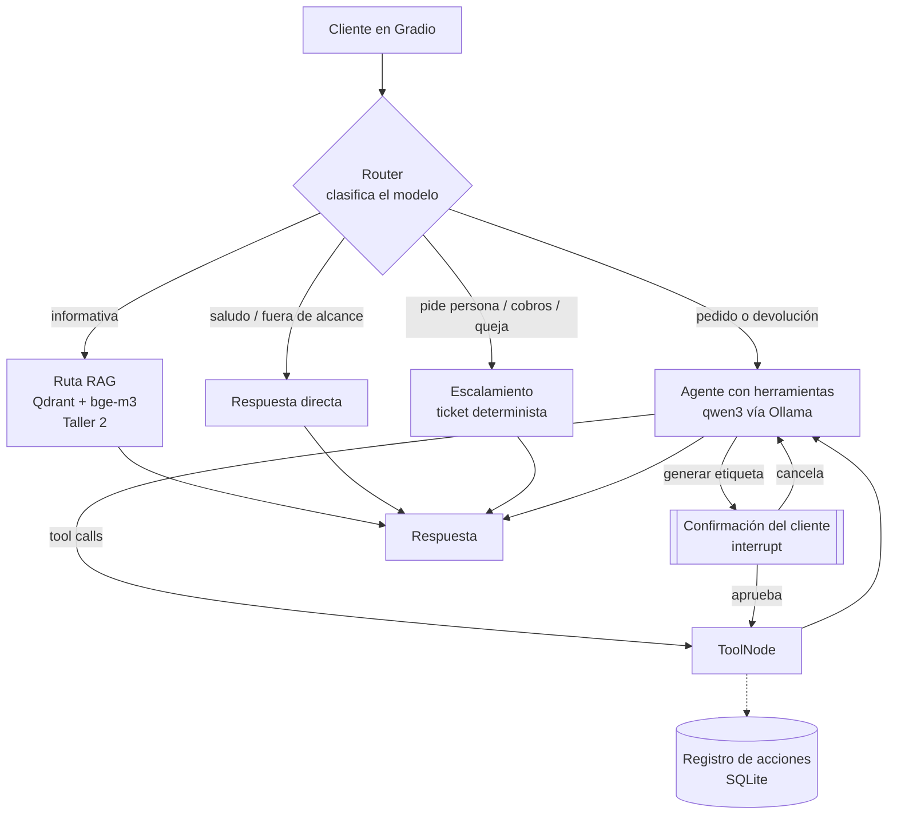
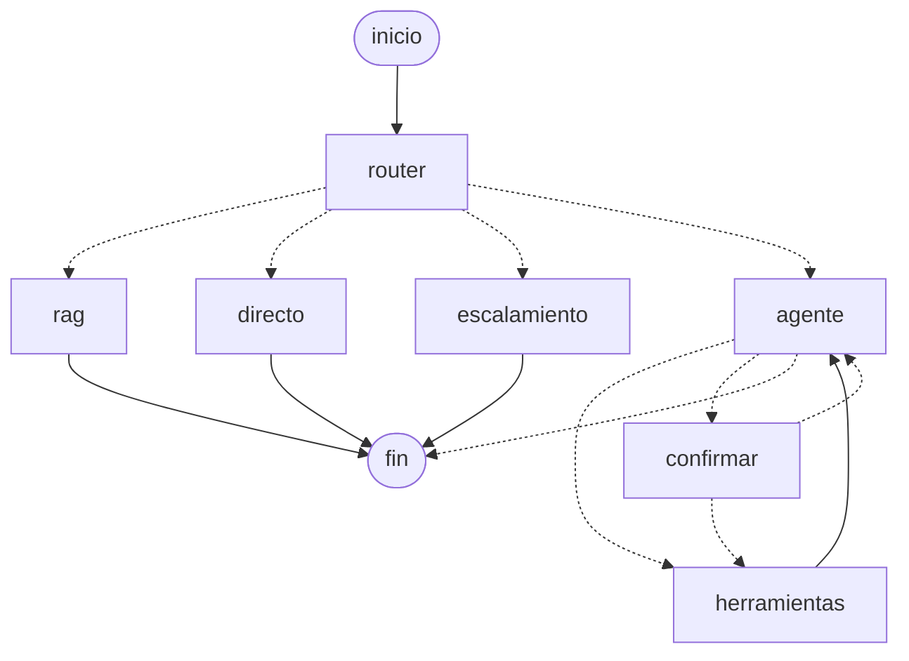
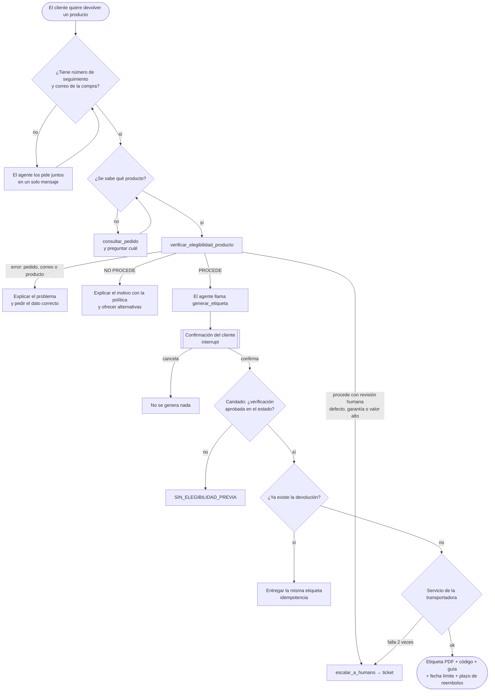

# Fase 1: Diseño de la arquitectura del agente

## 1. Del asistente RAG a un agente que actúa

En el Taller 2, el asistente de EcoMarket **respondía**: buscaba en la base de conocimiento y redactaba una respuesta. En este proyecto el asistente **actúa**: verifica si una devolución procede y genera la etiqueta de envío. Ese cambio define todo el diseño, porque una etiqueta generada por error tiene un costo real (logística, dinero y posible fraude). La pregunta central ya no es solo "¿responde bien?", sino **qué decide el modelo, qué decide el código y cuándo debe confirmar una persona**.

## 2. Cómo se incorpora el RAG: router + RAG como herramienta

El enunciado ofrece dos opciones para la arquitectura RAG existente: incorporarla como herramienta del agente o como una ruta alterna definida por reglas de entrada (arquitectura *router*). Usamos **las dos**, cada una donde aporta más:

| Opción | Dónde se usa | Por qué |
|---|---|---|
| **RAG como ruta del router** | Preguntas informativas ("¿cuánto cuesta el envío a Pasto?", "¿se puede devolver un champú?") | Son la mayoría de las consultas y no necesitan herramientas. Ir directo al RAG del Taller 2 es más rápido, más barato y más predecible que pasar por el agente |
| **RAG como herramienta** (`buscar_politica`) | Dentro del agente, mientras atiende una devolución | El agente puede citar la política sin abandonar el trámite |

El **router** clasifica cada mensaje con el **modelo** (número de seguimiento, frases como "quiero devolver" o "hablar con una persona" quedan en el prompt de `prompts.ROUTER`, no en código). Si el modelo no responde o devuelve algo que no es una ruta válida, el error se muestra al cliente en vez de decidir por él con una regla de respaldo: la misma postura que se sigue en los demás nodos (rag, directo, agente). La extracción de datos del cliente (número de seguimiento, correo) sí sigue siendo determinista con expresiones regulares, porque eso no es una decisión de negocio, es solo reconocer un formato.

## 3. Arquitectura general

El diagrama del grafo **real**, generado por LangGraph desde el código, está en [`grafo.mmd`](grafo.mmd):

## 4. Definición de las herramientas

El enunciado pide al menos dos herramientas sin contar el RAG. El agente tiene **cuatro de acción** más la herramienta de RAG. Todas son funciones de Python que simulan los sistemas de EcoMarket (pedidos, transportadoras, mesa de ayuda).

### Contrato común de respuesta

Todas las herramientas devuelven la misma estructura, así el agente siempre sabe si la acción salió bien y por qué falló:

| Campo | Tipo | Descripción |
|---|---|---|
| `ok` | booleano | Si la acción se completó |
| `datos` | objeto | El resultado (o datos de contexto del error) |
| `codigo_error` | texto | Solo si `ok` es falso; de una lista cerrada |
| `mensaje` | texto | Explicación legible, pensada para que el agente la traduzca al cliente |

### Las herramientas

| Herramienta | Qué hace | Recibe | Devuelve (éxito) | Errores posibles |
|---|---|---|---|---|
| `consultar_pedido` | Estado, fechas y productos de un pedido | `numero_seguimiento`, `correo` | estado, fechas, días desde la entrega, transportadora, enlace de rastreo, productos. Solo el **nombre** del cliente (minimización) | `DATOS_INCOMPLETOS`, `FORMATO_INVALIDO`, `PEDIDO_NO_EXISTE`, `IDENTIDAD_NO_COINCIDE` |
| `verificar_elegibilidad_producto` | Decide si un producto se puede devolver, **con reglas en código** | `numero_seguimiento`, `correo`, `producto` (nombre o parte), `motivo` (palabras del cliente) | `elegible`, `tipo` (estándar, no retornable, fuera de plazo, defectuoso, garantía, valor alto, ya registrada…), `razon`, `seccion_politica`, `requiere_revision_humana`, días, valor | los de `consultar_pedido` más `PRODUCTO_NO_ESPECIFICADO` y `PRODUCTO_NO_EN_PEDIDO` |
| `generar_etiqueta_devolucion` | Crea la devolución y la etiqueta en PDF | `numero_seguimiento`, `producto` (la elegibilidad la lee del **estado**, no del modelo) | `codigo_devolucion`, `guia`, transportadora, fecha límite de envío, instrucciones, plazo de reembolso, PDF | `SIN_ELEGIBILIDAD_PREVIA`, `REQUIERE_REVISION_HUMANA`, `TRANSPORTADORA_NO_DISPONIBLE`, `ACCIONES_DESHABILITADAS` |
| `escalar_a_humano` | Crea un ticket para un agente humano | `motivo`, `resumen`, `prioridad`, `numero_seguimiento` | `codigo_ticket`, prioridad | — |
| `buscar_politica` (RAG) | Busca en las políticas indexadas en Qdrant | `pregunta` | fragmentos con su fuente | `BASE_CONOCIMIENTO_NO_DISPONIBLE` |

### Tres decisiones de diseño sobre las herramientas

**a) La elegibilidad la decide el código, no el modelo.** En los Talleres 1 y 2 la decisión la tomaba un LLM "evaluador" leyendo la política. Ahora la decisión habilita una acción real, así que pasa a ser código determinista con las reglas en un orden fijo (estado del pedido → devolución existente → defecto → categoría no retornable → plazo → valor). La misma entrada da siempre el mismo resultado, se prueba con pruebas automáticas y **no se puede convencer con un prompt**. El modelo solo extrae los datos de la conversación y comunica el resultado.

**b) El candado: la etiqueta solo se genera con una verificación aprobada en el estado.** `verificar_elegibilidad_producto` escribe su resultado en el estado del grafo (con `Command` de LangGraph). `generar_etiqueta_devolucion` lee ese resultado con `InjectedState`, un parámetro que **el modelo no ve ni puede llenar**. Si no hay verificación aprobada para ese mismo pedido y producto, la herramienta se niega, aunque el modelo la llame directamente o el cliente diga "ya está verificado".

**c) Las acciones irreversibles llevan confirmación humana.** Antes de ejecutar `generar_etiqueta_devolucion`, el grafo se pausa (`interrupt`) y la interfaz muestra un resumen con los botones Confirmar y Cancelar.

### Casos que requieren una persona

Hay tres situaciones en que la verificación da "procede", pero el agente **no** genera la etiqueta y escala:
- **Producto defectuoso:** la política exige revisar una foto.
- **Garantía de tecnología:** la revisa el equipo técnico.
- **Valor alto** (más de 300.000 pesos, configurable): control de fraude.

## 5. Selección del marco: LangChain (LangGraph)

El enunciado pide elegir entre LangChain y LlamaIndex. Elegimos **LangChain**, usando **LangGraph**, que es su marco para construir agentes: desde la versión 1.0 de LangChain, sus propios agentes se ejecutan sobre LangGraph.

| Criterio | LangChain + LangGraph | LlamaIndex |
|---|---|---|
| Integración con el código base | El RAG del Taller 2 ya está hecho con LangChain (cargadores, segmentador, `QdrantVectorStore`, `ChatOllama`): se reutiliza sin cambios | Habría que adaptar o reescribir el RAG |
| Control del flujo | El flujo es un grafo explícito: el router, el agente, la confirmación y el escalamiento son nodos con aristas visibles y probables | Sus agentes son más "caja negra"; su fuerte es la indexación y consulta de documentos |
| Confirmación humana | `interrupt()` + checkpointer: pausa el grafo, espera al cliente y continúa, incluso después de reiniciar el servidor | Requiere implementarlo a mano |
| Herramientas | `@tool`, `ToolNode`, `InjectedState`, `InjectedToolCallId` y `Command`: lo necesario para el candado | Soporta herramientas, pero sin un equivalente directo a inyectar el estado |
| Memoria | Checkpointer en SQLite: cada conversación de Gradio tiene su propio hilo | Memoria de chat, sin persistencia de estado de un grafo |
| Depuración | LangGraph Studio y `draw_mermaid()` (el diagrama sale del código real) | Herramientas de trazas propias |

**Facilidad de uso:** la curva de aprendizaje de LangGraph es mayor que la de un agente prefabricado. Construimos el grafo a mano en lugar de usar el agente prefabricado (`create_agent`) porque necesitamos poner el router, el candado y la confirmación en lugares exactos. Ese control es justamente lo que permite demostrar cómo se conectan las piezas.

## 6. Flujo de trabajo del proceso de devolución

Decisiones del agente (el modelo): qué herramienta llamar, con qué argumentos y cómo comunicar el resultado. Decisiones del sistema (el código): si la devolución procede, si la etiqueta se puede generar y si ya existía. Decisión del cliente: confirmar o cancelar.

## 7. Componentes heredados de los talleres anteriores

| Componente | Origen | Uso en el proyecto |
|---|---|---|
| Extracción, segmentación, indexación y recuperación | Taller 2 | Ruta RAG y herramienta `buscar_politica`, sin cambios de lógica |
| Base de conocimiento (PDF, CSV, JSON) | Taller 2 | Igual |
| Consulta exacta de pedidos (sin RAG) | Taller 2 | Base de `consultar_pedido`, ahora con verificación de correo |
| Prompts del RAG | Taller 2 | Con la mejora de responder primero lo que se preguntó |
| Reglas deterministas (temas por palabras, número por expresión regular) | Taller 2 | Router y extracción de datos del cliente |
| Escalamiento con ticket y resumen | Talleres 1 y 2 | Herramienta y ruta de escalamiento |
| Evaluador LLM de devoluciones | Talleres 1 y 2 | **Reemplazado** por reglas en código |
