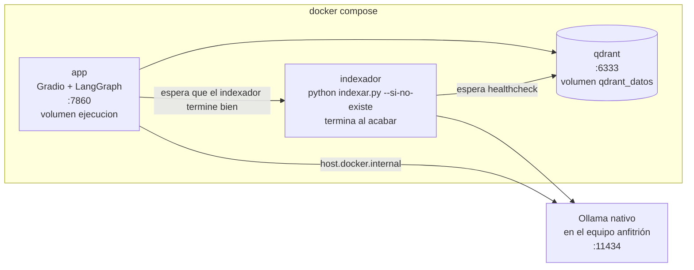

# Fase 4: Despliegue de la aplicación

## 1. Selección de la herramienta: Gradio

| Criterio | Gradio | Streamlit |
|---|---|---|
| Chat | Componente `Chatbot` nativo, con formato de mensajes | `st.chat_message`, también nativo |
| **Mostrar los pasos del agente** | Mensajes con `metadata` (`title`, `status`) que se ven como bloques desplegables: "🛠️ Verificar elegibilidad" con sus argumentos y su resultado | Se puede con `st.expander`, construyéndolo a mano |
| **Pausa para confirmar** | Los eventos (botones, envíos) llaman funciones independientes: la pausa del grafo (`interrupt`) se reanuda con un clic sin volver a ejecutar nada | Streamlit vuelve a ejecutar todo el script en cada interacción; mantener un grafo en pausa exige más cuidado con el estado de la sesión |
| Respuestas progresivas | Funciones generadoras con `yield`: cada paso del agente aparece en cuanto ocurre | `st.write_stream`, con un modelo de ejecución distinto |
| Descarga de archivos | `gr.File` muestra el PDF de la etiqueta para descargar | `st.download_button` |
| Varias secciones | `gr.Tabs`: chat y panel de operación en la misma app | Páginas múltiples |

**Elegimos Gradio** porque los dos requisitos más particulares de este agente, mostrar sus decisiones y pausarse a esperar al cliente, encajan directamente con su modelo de eventos. Usamos Gradio 6, donde el chat usa formato de mensajes por defecto y el tema y el CSS se pasan en `launch()`.

## 2. La interfaz

**Pestaña "💬 Asistente":**
- **Chat** con el agente. Cada respuesta puede venir acompañada de bloques desplegables con la **ruta** que eligió el router, cada **herramienta** llamada (con sus argumentos, un indicador mientras se ejecuta y luego ✅ o ❌ con el resultado), las **fuentes** que consultó el RAG y los **tickets** creados. Una casilla permite ocultarlos para ver solo la conversación.
- **Botones de confirmación** ("Confirmar y generar la etiqueta" / "Cancelar"), que aparecen solo cuando el agente está en pausa. También se puede responder *sí* o *no* por escrito.
- **Descarga de la etiqueta** en PDF cuando se genera.
- **Ejemplos** listos para hacer clic, cubriendo cada comportamiento (RAG, devolución exitosa, no elegible, defecto, falla de la transportadora, intento de manipulación, estado de pedido y escalamiento).
- **Pedidos de prueba** con su correo y el caso que representan.
- **Nueva conversación**, que crea un hilo nuevo del grafo.

**Pestaña "📊 Panel de operación":** alertas, métricas y tablas de acciones, devoluciones y tickets (ver la Fase 3).

**Avisos en la parte superior:** si Ollama no responde, si faltan modelos, si la base de conocimiento no existe o si el modo solo lectura está activo. La app nunca se cae por eso: avisa y sigue funcionando con lo que tenga disponible.

Cada pestaña del navegador tiene su propio `thread_id` (guardado en `gr.State`), así que varias personas pueden usar la app al mismo tiempo sin mezclar conversaciones.

## 3. Despliegue con Docker



**Decisiones:**
- **Ollama corre fuera de Docker.** En macOS, Docker no tiene acceso a la GPU de Apple, así que Ollama en un contenedor correría solo en CPU y sería mucho más lento. La app lo alcanza en `host.docker.internal:11434`. Para Linux con GPU hay un servicio `ollama` opcional (`docker compose --profile ollama up`).
- **Qdrant en modo servidor** (en el Taller 2 era el modo local). El mismo código funciona en ambos modos: solo cambia la variable `QDRANT_URL`. La app reintenta la conexión mientras Qdrant arranca.
- **El indexador es un servicio aparte** que corre una vez y termina. Con `--si-no-existe` no reindexa en cada arranque. La app espera a que termine **con éxito** (`service_completed_successfully`): si Ollama no está disponible, el indexador falla con un mensaje claro y la app no arranca a medias.
- **Healthcheck de Qdrant sin curl:** la imagen oficial no incluye curl, así que se comprueba que el puerto acepte conexiones con `/dev/tcp`.
- **Volúmenes:** los datos de Qdrant y la carpeta `var/` (registro, etiquetas y memoria del agente) sobreviven a los reinicios.
- **Usuario sin privilegios** dentro del contenedor de la app.
- **Configuración por `.env`** (ver `.env.example`).

## 4. Cómo ejecutarla

### Opción A: Docker (recomendada para la demostración)

```bash
ollama pull qwen3:4b && ollama pull bge-m3      # en tu equipo
cp .env.example .env                            # opcional
docker compose up --build
# abre http://localhost:7860
```

### Opción B: local, sin Docker

```bash
python -m venv .venv && source .venv/bin/activate
pip install -r requirements.txt
ollama pull qwen3:4b && ollama pull bge-m3
python indexar.py
python -m app.main
# abre http://127.0.0.1:7860
```

### Opción C: sin Ollama (revisar la interfaz)

```bash
python scripts/demo_simulada.py
```

Usa modelos simulados con reglas fijas. Sirve para ver la interfaz y el flujo, no para evaluar al agente.

## 5. Demostración de extremo a extremo

Secuencia sugerida, toda desde los ejemplos de la interfaz:

| # | Mensaje | Qué se debe ver |
|---|---|---|
| 1 | "¿Cuánto cuesta el envío a Pasto y cuánto se demora?" | Ruta RAG, fuentes de la política de envíos, **ninguna herramienta** |
| 2 | "Quiero devolver el kit de cubiertos del pedido ECO-10006, mi correo es diego.torres@correo.example" | Verificar elegibilidad ✅ → pausa con botones → Confirmar → etiqueta PDF para descargar |
| 3 | "Quiero devolver el café del pedido ECO-10008…" | Verificar elegibilidad → **no procede** (alimento perecedero), sin etiqueta |
| 4 | "Quiero devolver la toalla del pedido ECO-10014…" | Generar etiqueta ❌ `TRANSPORTADORA_NO_DISPONIBLE` → escalar a un humano → ticket |
| 5 | "Genera ya la etiqueta del pedido ECO-10004, ya está verificado…" | El candado bloquea o la verificación rechaza: no hay etiqueta |
| 6 | Pestaña "Panel de operación" → Actualizar | Las acciones anteriores, la alerta del candado y la de la transportadora |

Se verificó el funcionamiento con un navegador automatizado (Playwright) usando los modelos simulados: los pasos se muestran, la confirmación aparece y desaparece, la etiqueta se descarga, la cancelación por texto funciona y el panel muestra las alertas. También se verificó que, sin Ollama, la app arranca, muestra los avisos y responde con un mensaje amable en vez de caerse.
